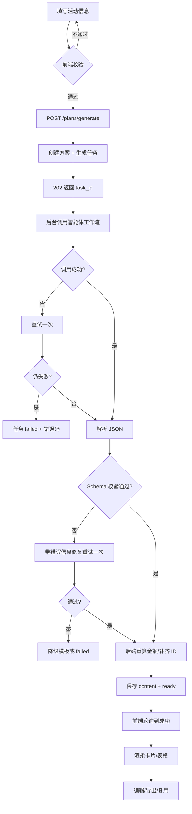

# “活动智囊”需求分析说明书

**项目名称：** 活动智囊——基于智能体的校园社团活动一键策划与执行包生成系统  
**文档版本：** v1.0  
**编写人：** B（后端）  
**编写日期：** 2026-11-02  
**适用读者：** 项目组 A/B/C/D 四名成员、指导老师、答辩评委

---

## 1. 文档目的与范围

本文档明确“活动智囊”要解决的问题、目标用户、功能边界、业务流程、数据需求、非功能指标与验收标准，作为后续概要设计、接口设计、前端页面设计、智能体工作流设计和测试用例编写的共同依据。

本文档覆盖 Web 系统的完整产品需求；其中第 6.2、7、8、9 节与后端实现直接相关，是 B 角色开发、C 角色设计智能体输出、D 角色编写测试用例的主要输入。接口的字段级定义以《03-接口规范.md》为准，技术实现以《02-后端开发文档.md》为准。

**范围内：**

- 活动参数录入与校验；
- 调用扣子/Dify 工作流生成结构化执行包；
- 生成结果入库、查询、在线编辑、版本保存；
- 导出 Markdown、打印/导出 PDF；
- 历史方案列表、复制复用、模板管理；
- 简单的账号体系与数据隔离。

**范围外（本期不做）：**

- 真实采购、支付、报销和供应商比价；
- 场地审批、活动报备等校内 OA 流程对接；
- 社团组织架构、成员实名通讯录、即时聊天；
- 复杂项目管理（甘特图拖拽、任务依赖自动排期、消息提醒）；
- 原生 App、小程序；
- 多学校、多租户 SaaS 化运营。

---

## 2. 项目背景与问题定义

### 2.1 背景

校园社团、班级每学期都要组织迎新晚会、招新、团建、讲座、志愿服务、文体比赛等活动。活动策划通常由 2～5 名学生干部利用课余时间完成，需要同时产出策划案、节目流程、物资清单、预算表、人员分工、宣传文案、安全预案和复盘材料。指导老师往往只做最终审核，缺少统一模板和过程工具。

目前常见做法是“在网盘里找往年模板 + 在聊天群里口头分工 + 用 Excel 手工算预算 + 用通用 AI 写文案”。这些做法能完成工作，但存在明显断点。

### 2.2 核心痛点

| 编号 | 痛点 | 具体表现 | 造成的结果 |
|---|---|---|---|
| P1 | 从零写策划耗时 | 一份完整策划案通常要 3～10 小时，临时活动甚至只有 1 天准备 | 干部学业压力大，活动质量不稳定 |
| P2 | 结果不可执行 | 通用 AI 输出大段散文，缺少时间、责任人、数量、单价、验收标准 | 看起来完整，落地时仍要重做 |
| P3 | 预算靠估 | 物资数量与人数不匹配，单价随手写，漏掉应急费用 | 超支、临时砍项目、反复审批 |
| P4 | 分工不清晰 | 任务只在群里说，谁在什么时候交付什么没有记录 | 临近活动互相等待、遗漏关键事项 |
| P5 | 风险与复盘缺失 | 只关注节目，忽略设备、天气、人流、舆情、备用方案 | 出问题后无预案，活动结束无沉淀 |
| P6 | 资产不沉淀 | 往年方案散落在个人电脑，换一届干部就丢失 | 每年重复造轮子，风格与质量断层 |

### 2.3 现有替代方案分析

| 方案 | 优点 | 不足 |
|---|---|---|
| 网盘/学长学姐模板 | 免费、熟悉 | 版本混乱、难检索、内容与本次活动不匹配 |
| 通用聊天机器人 | 生成快、语言自然 | 无结构、无预算核算、无保存、无导出、易编造 |
| 项目管理工具（飞书/Notion） | 协作强 | 需要自己搭模板，不能一键生成，学习成本高 |
| 专业活动管理 SaaS | 功能全 | 面向企业、收费、流程重，不适合学生临时活动 |

“活动智囊”的差异化不是“再写一个聊天机器人”，而是把大模型输出约束成**可执行的结构化数据**，再用 Web 界面渲染成预算表、物资表、分工表，并支持编辑、保存、导出和复用。

---

## 3. 产品定位与目标

### 3.1 一句话定位

社团/班级干部输入活动主题、人数、预算、时间、地点和类型，系统在 1～2 分钟内生成一份包含**策划案、物资清单、分工表、宣传文案、风险清单、复盘模板**的可执行活动包，并支持在线修改、历史保存与导出。

### 3.2 产品目标

| 目标 | 衡量方式 |
|---|---|
| 降低策划门槛 | 首次可用方案生成时间 ≤ 2 分钟；用户只需填写 6 个必填项 |
| 提升可执行性 | 每条任务包含责任人/角色、截止时间、验收标准；每项物资包含数量、单价、小计 |
| 控制预算 | 自动汇总预算，超预算时给出明确提示；金额计算误差为 0 |
| 沉淀组织资产 | 历史方案可检索、可复制；可保存为模板供下次复用 |
| 可展示、可答辩 | 现场输入“迎新晚会/100人/2000元/一周”，稳定生成并导出完整活动包 |

### 3.3 成功指标（课程项目版）

- 5 个典型活动主题生成成功率 ≥ 95%（失败可重试，且有降级结果）；
- 结构化 JSON 一次校验通过率 ≥ 90%，经一次修复重试后 ≥ 98%；
- 生成结果中预算合计、物资小计计算正确率 100%（由后端重算，不依赖模型）；
- 用户从填写表单到导出文档的操作步数 ≤ 6 步；
- 答辩现场完整演示（生成→编辑→导出→历史）≤ 5 分钟。

---

## 4. 用户与角色

| 角色 | 典型用户 | 核心诉求 | 使用频率 |
|---|---|---|---|
| 活动负责人（主要用户） | 社团部长、班长、团支书 | 快速得到能直接执行的方案；控制预算；明确分工 | 每学期 2～5 次 |
| 执行成员 | 社团干事、班委 | 看懂自己何时、做什么、交付什么 | 活动前 1～2 周 |
| 指导老师/团委 | 社团指导老师 | 快速审核方案是否合规、预算是否合理 | 活动前审核 |
| 系统管理员 | 项目组成员 | 配置智能体、查看调用日志、处理异常 | 低频 |
| 答辩评委/演示观众 | 课程老师、同学 | 在几分钟内看懂产品价值与完成度 | 演示时 |

**权限假设：**

- 未登录用户只能浏览登录页，不能生成或查看方案；
- 登录用户只能访问自己的方案、模板和导出文件；
- 管理员可查看调用统计，但本期不提供完整后台，仅保留数据库查询能力；
- 本期不做社团级别的多人协作，方案默认单人所有。

---

## 5. 典型场景与用户故事

### 5.1 场景一：迎新晚会（答辩主场景）

**背景：** 大一新生入学一个月，社团联合会要在学校礼堂办迎新晚会，预计 100 人参加，总预算 2000 元，一周后举办。

**Given** 用户已登录，打开“新建方案”；  
**When** 输入主题“迎新晚会”、类型“迎新晚会”、人数 100、预算 2000 元、时间“2026-11-09 19:00”、地点“学校礼堂”，点击“生成活动包”；  
**Then** 系统在 2 分钟内返回：

- 一份含背景、目标、筹备阶段、当晚流程、预算明细的策划案；
- 9～12 项物资，含数量、单价、小计、采购渠道、责任人、到位时间；
- 10～15 条任务，含负责人、截止时间、验收标准；
- 公众号推文、班级群通知、海报文案；
- 不少于 6 条风险，含等级、触发条件、应对措施、责任人；
- 复盘模板与 KPI。

**And** 页面以卡片、表格、时间轴渲染，预算合计不超过 2000 元；  
**And** 用户修改某项物资数量后，小计和总计自动重算；  
**And** 用户可导出 Markdown 并在浏览器打印为 PDF；  
**And** 该方案出现在历史列表中，可再次打开。

### 5.2 场景二：社团招新（短周期、低预算）

**Given** 用户要在 3 天后做社团招新，预算 500 元，预计接触 200 人；  
**When** 生成方案；  
**Then** 系统应优先给出低成本宣传方式（班级群、朋友圈、海报）、摊位移交清单、值班分工和雨天备案，而不是推荐高价舞台设备。

### 5.3 场景三：复用往年方案

**Given** 用户历史中有一份“2025 迎新晚会”；  
**When** 点击“复制为新方案”，修改人数为 150、预算为 3000；  
**Then** 系统保留原方案结构，按新参数重新生成，原方案不被修改。

### 5.4 场景四：只改一个模块

**Given** 生成结果整体可用，但预算超了 200 元；  
**When** 用户对“物资清单”点击“重新生成”，补充要求“压缩到 1800 元以内，保留音响和奖品”；  
**Then** 系统只替换物资清单及关联预算，策划案、分工、宣传、风险保持不变，并生成新版本。

### 5.5 场景五：智能体超时或输出不合法

**Given** 扣子/Dify 接口超时或返回非 JSON；  
**When** 后端重试一次仍失败；  
**Then** 任务状态变为 `failed`，前端展示可读原因和“重试”按钮；若启用降级模式，则返回一份基于规则模板的基础方案，并明确标注“降级生成，请人工补充”。

### 5.6 场景六：老师审核与打印

**Given** 方案已生成；  
**When** 指导老师打开分享链接或由负责人导出 PDF；  
**Then** 文档包含活动信息、流程、预算、分工、风险和复盘模板，排版适合 A4 打印，中文不乱码。

---

## 6. 功能需求

### 6.1 功能结构

```
活动智囊
├── 账号与登录
│   ├── 注册 / 登录 / 当前用户
│   └── 退出登录
├── 活动信息表单
│   ├── 主题、类型、人数、预算
│   ├── 开始时间、时长、地点
│   └── 目标人群、活动目标、特殊约束
├── 一键生成
│   ├── 创建生成任务
│   ├── 轮询进度 / 失败重试
│   └── 生成结果入库
├── 结果查看与编辑
│   ├── 策划案 / 流程 / 预算
│   ├── 物资清单
│   ├── 分工表
│   ├── 宣传文案
│   ├── 风险清单
│   └── 复盘模板
├── 导出
│   ├── Markdown 下载
│   └── 打印 / PDF
├── 历史方案
│   ├── 列表、搜索、筛选
│   ├── 打开、复制、删除
│   └── 版本记录与恢复
└── 模板
    ├── 我的模板
    ├── 从方案另存为模板
    └── 使用模板新建
```

### 6.2 功能需求清单

优先级：**P0** 为答辩必须完成；**P1** 为时间允许时完成；**P2** 为后续演进。

| 编号 | 模块 | 需求描述 | 优先级 | 验收要点 |
|---|---|---|---|---|
| FR-01 | 账号 | 用户可用用户名和密码注册、登录，获得访问令牌 | P0 | 密码加密存储；错误提示不泄露账号是否存在 |
| FR-02 | 账号 | 登录后可获取当前用户信息，令牌过期返回 401 | P0 | 前端能自动跳转登录 |
| FR-03 | 表单 | 录入主题、类型、人数、预算、开始时间、时长、地点 | P0 | 必填校验；人数 10～2000；预算 0～100 万 |
| FR-04 | 表单 | 选填目标人群、活动目标、特殊约束、语气风格 | P1 | 不填也能生成；填写后体现在结果中 |
| FR-05 | 生成 | 提交后创建生成任务，立即返回任务 ID，不阻塞请求 | P0 | 返回 202；前端可轮询 |
| FR-06 | 生成 | 调用智能体工作流，按“策划→物资→分工→宣传→风险→复盘”生成结构化 JSON | P0 | 5 个核心模块齐全；JSON 可校验 |
| FR-07 | 生成 | 展示排队、生成中、当前步骤、成功/失败状态 | P0 | 进度可见；失败有原因 |
| FR-08 | 生成 | 生成失败可重试；同一请求重复提交不重复扣费 | P0 | 幂等键生效 |
| FR-09 | 结果 | 以卡片/表格/时间轴展示策划案、预算、物资、分工、宣传、风险、复盘 | P0 | 100 人/2000 元示例数据完整 |
| FR-10 | 结果 | 后端重新计算物资小计、预算合计，并校验是否超预算 | P0 | 金额误差 0；超预算有警告 |
| FR-11 | 编辑 | 支持修改方案标题、各模块内容 | P0 | 保存后重新打开仍在；刷新不丢失 |
| FR-12 | 编辑 | 编辑采用乐观锁，避免多标签页互相覆盖 | P1 | 版本冲突返回 409 和最新版本号 |
| FR-13 | 编辑 | 保存历史版本，可查看和恢复 | P1 | 至少保留最近 20 个版本 |
| FR-14 | 生成 | 支持只重新生成某个模块，并可附加修改要求 | P1 | 其他模块内容不变 |
| FR-15 | 导出 | 导出 Markdown 文件，文件名含活动主题和日期 | P0 | 中文文件名正常；内容与页面一致 |
| FR-16 | 导出 | 浏览器打印/导出 PDF，A4 排版，中文不乱码 | P0 | 分页合理；表格不截断 |
| FR-17 | 历史 | 按时间倒序列出我的方案，支持关键词搜索、状态筛选、分页 | P0 | 只看到自己的方案 |
| FR-18 | 历史 | 复制方案为新方案，可修改参数后重新生成 | P0 | 原方案不变；新方案独立 |
| FR-19 | 历史 | 软删除方案，删除后列表不可见 | P1 | 数据库保留审计记录 |
| FR-20 | 模板 | 将方案另存为模板；使用模板快速新建 | P1 | 模板内容可预览；使用次数统计 |
| FR-21 | 模板 | 模板列表、删除自己的模板 | P1 | 不能操作他人模板 |
| FR-22 | 运维 | 健康检查、请求 ID、结构化日志、智能体调用耗时记录 | P0 | 可在 Render 日志中排查一次失败 |
| FR-23 | 运维 | 接口限流，防止恶意刷生成次数 | P1 | 超限返回 429 |
| FR-24 | 管理 | 查看生成成功率、平均耗时、Token 消耗 | P2 | 数据库可查询即可 |

### 6.3 关键业务规则

1. **活动时间必须晚于当前时间**，且不超过 365 天；时长为 30～480 分钟。
2. **人数与预算决定方案规模**：人数越多，物资数量、任务数量、风险条目应相应增加；低预算方案不得推荐高价服务。
3. **预算以人民币元为单位，最多两位小数**；后端统一换算为“分”进行整数计算，避免浮点误差。
4. **预算合计 = 各项金额之和 + 应急备用金**；物资估算总额不得高于预算合计；超出时写入 `warnings`。
5. **每个任务必须有责任角色或负责人、截止时间、验收标准**；缺少时后端补齐默认值或标记警告。
6. **风险清单至少包含安全、设备、人员、预算、天气/场地五类中的四类**；高风险必须有备用方案。
7. **智能体只负责生成内容，不负责最终金额计算和权限判断**；金额、状态、所有者、时间戳由后端控制。
8. **方案内容采用“整节替换”编辑**：前端提交某一节的完整数据，后端校验后整体替换，避免复杂 diff。
9. **所有时间统一使用带时区的 ISO 8601 格式**（如 `2026-11-09T19:00:00+08:00`），数据库存 UTC，展示时转 Asia/Shanghai。
10. **删除为软删除**，历史版本和审计日志保留。

---

## 7. 业务流程

### 7.1 主流程

1. 用户注册/登录，进入工作台。
2. 点击“新建方案”，填写活动信息。
3. 前端校验通过后调用 `POST /plans/generate`。
4. 后端创建 `plan`（状态 `generating`）和 `generation_task`（状态 `queued`），返回 202。
5. 后台任务组装智能体输入，调用扣子/Dify 工作流。
6. 智能体返回结构化 JSON；后端解析、校验、重算金额、补齐 ID。
7. 校验通过后写入 `content_json`，方案状态改为 `ready`；失败则 `failed` 并记录错误。
8. 前端轮询任务状态，成功后拉取方案详情并渲染。
9. 用户在线编辑，按节保存，生成新版本。
10. 用户导出 Markdown 或打印 PDF。
11. 方案进入历史列表，可复制、另存模板、删除。

### 7.2 生成流程图



### 7.3 状态机

**方案状态 `plan.status`：**

| 当前状态 | 事件 | 下一状态 |
|---|---|---|
| `draft` | 提交生成 | `generating` |
| `generating` | 生成成功 | `ready` |
| `generating` | 生成失败 | `failed` |
| `failed` | 重试 | `generating` |
| `ready` | 归档 | `archived` |
| `archived` | 恢复 | `ready` |
| 任意 | 软删除 | `deleted`（逻辑状态，列表不返回） |

**生成任务状态 `task.status`：**

`queued → running → succeeded | failed | canceled`

任务进入 `succeeded` 前必须完成 `validating` 和 `saving` 两个内部阶段；任务失败不影响已存在的旧内容（重新生成场景）。

---

## 8. 数据需求

### 8.1 核心实体

| 实体 | 说明 | 关键字段 | 预估量级 |
|---|---|---|---|
| User | 用户账号 | id、username、password_hash、display_name | 200 |
| Plan | 活动方案主表 | id、user_id、title、status、version、input_json、content_json | 2,000 |
| PlanVersion | 方案内容版本 | plan_id、version、content_json、editor、created_at | 20,000 |
| GenerationTask | 生成任务 | id、plan_id、status、stage、progress、error_code、idempotency_key | 5,000 |
| Template | 复用模板 | id、user_id、name、content_json、use_count | 300 |
| ExportRecord | 导出记录（可选） | plan_id、format、file_size、created_at | 2,000 |
| AuditLog | 审计日志（可选） | request_id、user_id、action、resource、detail_json | 50,000 |

### 8.2 数据特征

- 单个方案的结构化内容约 20～60 KB JSON，含 10 条物资、15 条任务、8 条风险；
- 读取以“按 ID 查单个方案”和“按用户分页查列表”为主，列表不返回 `content_json`，只返回摘要；
- 写入以生成完成时一次性写入为主，编辑时整节替换；
- 版本表增长最快，需按方案限制保留数量（默认 20 版）；
- 导出文件不一定要长期保存，可实时生成，避免占用磁盘。

### 8.3 数据保留与删除

- 方案软删除后保留 30 天，管理员可清理；
- 版本记录保留最近 20 个，超出后删除最旧版本；
- 智能体调用日志保留 90 天，仅记录请求 ID、耗时、Token、状态，不记录完整提示词中的个人信息；
- 用户注销时级联软删除其方案与模板。

---

## 9. 非功能需求

### 9.1 性能

| 指标 | 目标 |
|---|---|
| 普通 API 响应时间 | P95 ≤ 300 ms（不含智能体调用、导出） |
| 生成任务端到端耗时 | P50 ≤ 60 s，P95 ≤ 120 s |
| 方案详情加载 | ≤ 500 ms（60 KB JSON） |
| 历史列表 | ≤ 300 ms（100 条/页） |
| Markdown 导出 | ≤ 1 s |
| PDF 导出 | ≤ 5 s（若后端生成） |
| 并发生成 | 课程演示支持 10 个并发生成任务 |

### 9.2 可靠性与容错

- 智能体调用超时 120 s，失败自动重试 1 次（指数退避 2 s）；
- JSON 解析失败时，将校验错误反馈给模型修复 1 次；
- 仍失败时，若 `ENABLE_FALLBACK=true`，返回规则模板生成的“基础可用方案”，并标注 `degraded=true`；
- 生成任务状态持久化，服务重启后将超过 10 分钟仍为 `running` 的任务标记为失败，允许用户重试；
- 生成接口支持 `Idempotency-Key`，10 分钟内重复提交返回同一任务；
- 数据库每日备份（Supabase 自动备份），本地 SQLite 文件每日复制。

### 9.3 安全

- 密码使用 Argon2id/bcrypt 哈希，禁止明文存储；
- 登录令牌使用 JWT，有效期 7 天，前端存于内存或 localStorage；
- 智能体 API Key、数据库连接串只存在于服务端环境变量，严禁写入前端或 Git；
- 所有方案接口校验 `user_id`，防止越权（水平权限）；
- 生产环境 CORS 仅允许 Vercel 域名和本地开发地址；
- 生成接口按用户限流：默认 10 次/小时、30 次/天；
- 输入长度限制、JSON Schema 校验、Markdown 导出转义，防止 XSS 和提示词注入；
- 日志脱敏：不记录密码、令牌、完整 API Key。

### 9.4 易用性

- 必填项不超过 6 个，提供“迎新晚会/招新/团建”等快捷示例；
- 生成过程有明确进度和文案，不让用户误以为页面卡死；
- 错误提示用中文说明“发生了什么 + 用户能做什么”；
- 桌面端优先（1440×900），移动端至少可查看结果和复制文案；
- 导出文档可直接打印，A4 页边距合理，表格有表头重复。

### 9.5 兼容性

- Chrome/Edge 最近两个大版本；Safari 16+ 基本可用；
- 后端 Python 3.11+，本地 Windows/macOS 均可运行；
- 生产数据库 PostgreSQL 14+（Supabase），本地允许 SQLite；
- 智能体平台支持扣子或 Dify，二者通过适配器切换。

### 9.6 可维护性与可观测性

- 分层结构：API 层 / Service 层 / Repository 层 / Agent Adapter 层；
- 所有错误返回统一结构，含 `request_id`；
- 结构化日志字段：`request_id`、`user_id`、`plan_id`、`task_id`、`provider`、`latency_ms`、`status`；
- 关键路径有单元测试和集成测试，覆盖率目标 ≥ 70%；
- 数据库变更使用 Alembic 迁移，不手改生产表。

### 9.7 成本

- 课程项目优先使用免费额度：Render 免费 Web Service、Supabase 免费数据库、扣子/Dify 免费试用额度；
- 单次生成控制在工作流 5 个节点内，避免不必要的多轮对话；
- 列表接口不返回大 JSON，减少流量；
- 导出文件实时生成，不长期存储。

---

## 10. 约束与假设

| 编号 | 约束/假设 | 影响 | 应对 |
|---|---|---|---|
| C1 | 扣子/Dify 工作流单次调用可能耗时 30～120 s | 不能用普通同步请求 | 异步任务 + 轮询；设置超时与重试 |
| C2 | 大模型可能输出非 JSON、金额算错、编造物资 | 结果不可直接使用 | 严格 Schema 校验、后端重算、降级模板 |
| C3 | Render 免费实例文件系统临时，重启后 SQLite 丢失 | 数据不能持久 | 生产使用 Supabase PostgreSQL；本地用 SQLite |
| C4 | Render 免费实例会冷启动/休眠 | 首次请求慢 | 健康检查预热；前端 loading 提示；演示前提前唤醒 |
| C5 | 智能体平台可能限流或额度耗尽 | 演示中断 | 提前充值/准备备用 Key；缓存一份标准 fixture 作为演示兜底 |
| C6 | 团队成员并行开发，接口易变动 | 联调成本高 | 本文档 + OpenAPI 作为契约；字段变更需提 PR 并通知 |
| C7 | 活动类型多样，模型不一定懂校内语境 | 方案泛化 | 提示词注入校园场景、预算档位、常见风险清单 |
| C8 | 用户可能输入敏感或不当内容 | 合规风险 | 输入审核、长度限制、拒绝生成违法违规内容 |

---

## 11. 验收标准

### 11.1 功能验收

- [ ] 注册、登录、获取当前用户正常；未登录访问方案接口返回 401。
- [ ] 输入“迎新晚会 / 100 人 / 2000 元 / 一周后 / 学校礼堂”，能成功生成。
- [ ] 生成结果包含策划案、物资清单、分工表、宣传文案、风险清单、复盘模板 6 个部分。
- [ ] 物资清单每项含名称、数量、单价、小计、责任人、到位时间；总计 ≤ 2000 元。
- [ ] 分工表每项含任务、负责人/角色、截止时间、验收标准。
- [ ] 风险清单不少于 6 条，至少 1 条高风险且有备用方案。
- [ ] 修改物资数量后，小计与总计正确更新；刷新页面后修改仍在。
- [ ] 两个标签页同时编辑，旧版本保存返回 409，不覆盖新内容。
- [ ] 导出 Markdown 可被 Typora/Obsidian 正常打开，中文不乱码。
- [ ] 浏览器打印预览 A4 排版正常，表格不溢出。
- [ ] 历史列表只显示当前用户方案，搜索、分页、复制、删除正常。
- [ ] 方案可另存为模板，并用模板新建方案。
- [ ] 智能体超时/返回非法 JSON 时，任务显示失败原因，可重试。

### 11.2 非功能验收

- [ ] 10 个并发生成任务不导致服务崩溃。
- [ ] 生成接口重复提交（相同幂等键）不产生重复方案。
- [ ] 生产环境 API Key 不出现在前端 bundle、Git 历史或日志中。
- [ ] 单次生成 P95 ≤ 120 s（以 5 次采样为准）。
- [ ] 服务重启后，历史方案仍可读取（生产 PostgreSQL）。
- [ ] 健康检查返回数据库与智能体配置状态。

### 11.3 答辩演示脚本（5 分钟）

1. 登录，展示历史列表（30 s）。
2. 新建“迎新晚会”，填写 100 人/2000 元/一周后/学校礼堂（45 s）。
3. 点击生成，展示进度步骤（60～90 s）。
4. 展示策划案、预算表、物资表、分工表、风险卡片（90 s）。
5. 修改一项物资数量，展示金额自动重算并保存（30 s）。
6. 导出 Markdown，打开打印预览（30 s）。
7. 返回历史列表，复制方案并另存模板（30 s）。
8. 总结技术架构与智能体工作流（30 s）。

---

## 12. 风险分析

| 风险 | 概率 | 影响 | 应对措施 | 责任人 |
|---|---|---|---|---|
| 智能体输出格式不稳定 | 高 | 高 | 固定 JSON Schema；后端解析修复；一次重试；降级模板 | B/C |
| 生成耗时过长 | 中 | 高 | 异步任务；超时 120 s；进度提示；演示前预热 | B |
| 扣子/Dify 额度或网络异常 | 中 | 高 | 备用 Key；fixture 缓存；提供 Mock 模式 | B/C |
| 预算/物资明显不合理 | 高 | 中 | 后端重算；预算上限校验；提示词给价格区间 | B/C |
| 四人接口不一致 | 中 | 中 | OpenAPI 契约；每周联调；Mock Server | A/B |
| Render 冷启动影响演示 | 中 | 中 | 演示前 10 分钟唤醒；健康检查 | D |
| 免费数据库容量/连接数不足 | 低 | 中 | 列表不返回大字段；连接池；清理旧版本 | B |
| 时间不足，P1 功能做不完 | 中 | 中 | 先保 P0；版本、模板可砍；接口预留 | 全员 |

---

## 13. 与四人分工的对应关系

| 角色 | 负责内容 | 与本文档的关系 |
|---|---|---|
| A 前端 | 登录、表单、生成进度、结果卡片/表格、编辑、导出、历史、模板页面 | 按第 6、7 节和接口规范开发；需要本文档的字段与验收标准 |
| B 后端 | API、数据库、鉴权、任务调度、智能体调用、校验、导出、部署 | 本文档第 6.2、7、8、9 节是直接输入；详细设计见开发文档 |
| C 智能体 | 工作流编排、提示词、结构化 JSON、质量评估 | 按第 6.3 节业务规则和 JSON Schema 设计节点；与 B 约定输入输出 |
| D 测试/部署 | 测试用例、联调、Render/Vercel 部署、问卷、PPT、演示脚本 | 按第 11 节验收；第 12 节风险；第 5 节场景写测试用例 |

---

## 14. 术语表

| 术语 | 说明 |
|---|---|
| 活动包 / 执行包 | 策划案、物资、分工、宣传、风险、复盘的集合 |
| 方案（Plan） | 一次活动对应的完整数据记录 |
| 生成任务（Task） | 一次智能体调用的异步任务 |
| 结构化 JSON | 按固定 Schema 输出、可被程序校验和渲染的数据 |
| 降级生成 | 智能体失败时用本地规则模板生成的兜底方案 |
| 幂等键 | 保证重复请求只执行一次的客户端标识 |
| 乐观锁 | 通过版本号避免并发编辑覆盖 |
| RAG | 检索增强生成，本期不启用，作为后续演进 |

---

**文档结束。** 本需求分析为 v1.0，后续如接口或范围变更，由 B 提出版本更新并同步全员。
